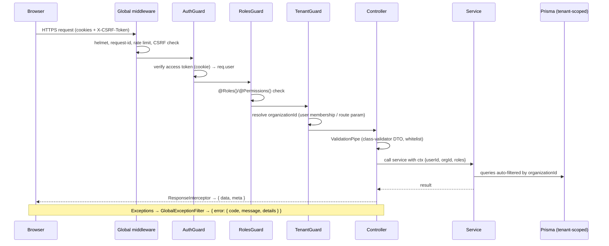

# Architecture

Impact Pro is a **modular monolith**: one NestJS API serves three Next.js frontends. Infrastructure services run alongside it, and the monolith stays a monolith until a module has a proven reason to split out.

## 1. System overview

```mermaid
flowchart LR
  subgraph Clients
    SF[Storefront<br/>Next.js :3000]
    AD[Admin<br/>Next.js :3001]
    PO[Customer Portal<br/>Next.js :3002]
  end
  subgraph API["apps/api — NestJS modular monolith (:4000, /api/v1)"]
    HTTP[HTTP layer<br/>guards · pipes · interceptors]
    MOD[Domain modules]
    WK[Postgres-backed workers (pg-boss)]
  end
  PG[(PostgreSQL)]
  MS[(Meilisearch)]
  S3[(MinIO / S3)]
  PSP[Payment providers<br/>card · MonCash · NatCash]
  CAR[Carriers / email / SMS]

  SF & AD & PO -->|HTTPS + cookies| HTTP --> MOD
  MOD --> PG
  MOD -->|rate limit in memory, ISR cache in Next.js| MOD
  MOD -->|enqueue (Postgres queue)| PG --> WK
  WK --> PG & MS & S3 & CAR
  MOD -->|search queries| MS
  MOD -->|presigned URLs| S3
  PSP -->|webhooks| HTTP
```

| Component | Tech | Responsibility |
|---|---|---|
| `apps/storefront` | Next.js App Router, Tailwind, shadcn/ui | Public catalog, SEO, cart, checkout, quotes, consultation booking |
| `apps/admin` | Next.js | Internal operations: catalog, orders, procurement, inventory, production, QC, fulfillment, reports |
| `apps/portal` | Next.js | Enterprise customers: programs, orders, inventory visibility, production progress, shipments |
| `apps/api` | NestJS, Prisma | All business logic; the single source of truth |
| PostgreSQL 16 | Prisma ORM | Transactional data, inventory ledger |
| _(no Redis)_ | — | **Decision 2026-11-26:** Redis was removed. Background jobs will use a Postgres queue (`pg-boss`) when first needed; rate limiting is in memory (single API instance); refresh-token denylist lives in Postgres. Redis can be added back if the API ever runs on several instances. |
| Meilisearch | — | Product/catalog full-text search and faceting |
| MinIO (dev) / S3 (prod) | AWS SDK v3 | Product images, production media, inspection attachments, documents |

Frontends never talk to Postgres or S3 directly. The only exception is fetching objects from S3 through **presigned URLs** issued by the API.

## 2. Module boundaries and dependency rules

Modules live in `apps/api/src/modules/<name>/` and are grouped by domain:

```
core/        config, prisma, queue (pg-boss, later), storage, search, audit, health
identity/    auth, users, roles, organizations
catalog/     catalog, categories, attributes, variants, pricing
commerce/    carts, checkout, orders, payments
supply/      suppliers, procurement, purchase-orders
inventory/   warehouses, locations, inventory, movements, reservations
programs/    programs, program-locations, allocations
production/  production-jobs, milestones, media, inspections
fulfillment/ kits, fulfillment-orders, pick-lists, packing, packages, shipments
engagement/  crm, notifications
insights/    analytics, reporting
```

Rules:
1. **Public surface only.** A module exports only its *service facade* (for example `InventoryService.reserve()`). Other modules never import its repositories, DTOs or Prisma models directly.
2. **Dependencies flow one way:** `core ← identity ← catalog ← (commerce | supply | inventory) ← (programs | production) ← fulfillment ← insights`. Lower layers never import higher ones. Upward notifications go through **domain events** (`@nestjs/event-emitter` in-process; a Postgres queue when the work is async).
3. **One owner per table.** Only the owning module writes its tables. For example, only `inventory` writes `InventoryMovement`. Any other module that needs a change calls `inventory`.
4. **Cross-module transactions** use a shared `Prisma.TransactionClient` passed explicitly (`tx`) into facade methods. This is how `checkout` reserves stock and creates the order atomically.
5. An ESLint `import/no-restricted-paths` rule plus a `dependency-cruiser` check in CI enforce rules 1–2.

## 3. Request flow



## 4. Multi-tenancy

- Every customer-owned row carries `organizationId` and is indexed on it. This covers orders, carts, programs, allocations, org inventory, documents and members.
- **TenantContext.** An `AsyncLocalStorage` holds `{ userId, organizationId, isStaff }` for the life of the request. `TenantGuard` sets it.
- **Prisma client extension** (`prisma.$extends`). On models listed in `TENANT_MODELS`, it injects `where: { organizationId }` into `findMany/findFirst/count/updateMany/deleteMany` and injects `data.organizationId` on `create`. `findUnique` is rewritten to `findFirst` with the tenant filter. Staff roles get an unscoped client, explicitly via `prisma.unscoped()`, and that call is audit-logged.
- **Defense in depth.** Guards check that route params belong to the org. Integration tests assert that org A gets **404 (not 403)** on org B's resources. Postgres Row-Level Security is a Phase 12 hardening option.

## 5. Background jobs (Postgres queue — `pg-boss`, added with the first async feature)

| Queue | Producers | Jobs |
|---|---|---|
| `search-index` | catalog | upsert/delete product docs in Meilisearch |
| `notifications` | orders, shipments, production, QC | email/SMS/WhatsApp, in-app |
| `media` | uploads | virus scan, thumbnails, EXIF strip |
| `inventory` | scheduler | low-stock alerts, reservation expiry, reconciliation |
| `reports` | reporting | CSV/PDF generation to S3 |
| `payments` | payments | webhook processing, reconciliation |

Jobs are idempotent: each carries an idempotency key, and the worker checks it before applying effects. They retry with exponential backoff, and exhausted jobs go to a dead-letter queue that the admin can see. Workers run in the same codebase. In production they can start as a separate process: `node dist/worker.js`.

## 6. File storage

- Bucket layout: `public/` (catalog images, served via CDN) and `private/{organizationId}/…` (production media, inspection reports, documents).
- Uploads use presigned POST with content-type and size conditions. The API records a `FileObject` row in `PENDING`. After the `media` job's validation (MIME sniffing, size limits, AV scan), the row becomes `READY`.
- Private downloads use presigned GET URLs with a short TTL (5 min), issued only after an org/role check.

## 7. Search indexing

- Meilisearch index `products`, with documents denormalized from Product, Variant, Category and Attributes.
- Filterable: `categorySlugs, attributes.*, priceMin, priceMax, decorationMethods, isActive, minQty`. Sortable: `price, createdAt, popularity`.
- Write path: the catalog emits `product.changed`, the `search-index` job upserts the document, and a nightly full reindex catches any drift.
- Customer-specific catalogs filter by `visibleToOrgIds` (empty = public).

## 8. Environments

| Env | Purpose | Infra |
|---|---|---|
| `local` | Development | `infra/docker-compose.yml` (postgres, meilisearch, minio, mailpit) |
| `test` | CI | Ephemeral service containers; `prisma migrate deploy` + seed |
| `staging` | QA / UAT | Same images as prod; anonymized data |
| `production` | Live | Managed Postgres (PITR), S3 + CDN, containers behind a TLS load balancer |

Configuration comes **only** from environment variables, validated at boot by a Zod schema (`ConfigModule`). Each app commits an `.env.example`; real `.env` files are git-ignored. Production secrets come from the platform's secret manager.

CI (GitHub Actions) runs install → lint → typecheck → unit tests → API integration tests (with a Postgres service) → build → Playwright E2E (on main/PR).
